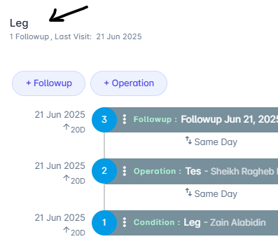
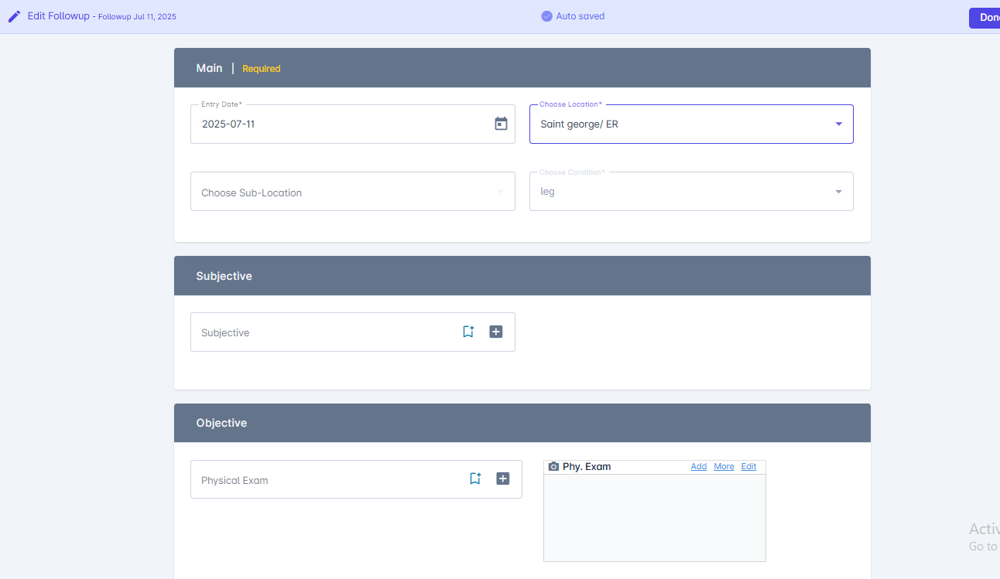
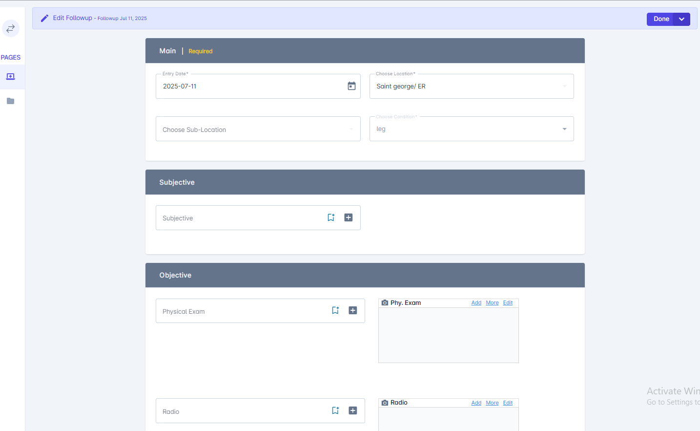

<Warning>
  Sample content for review. Replace these entries with real releases before publishing.
</Warning>

<Update label="Nov 11, 2026" description="v3.4" tags={["New", "Improved", "Fixed"]}>
  ## Faster follow-ups from a condition

  <Badge color="blue" size="sm">New</Badge>

  Add a follow-up directly from the condition it belongs to. The follow-up opens with the condition already linked, so you only fill in the date, purpose and notes.

  <Frame caption="Select + Follow-Up on the condition to start a linked follow-up">
    
  </Frame>

  <Accordion title="More screenshots" icon="images">
    <Frame caption="Enter the follow-up date, purpose and notes">
      
    </Frame>
    <Frame caption="Each follow-up keeps its SOAP sections, medication and attachments">
      
    </Frame>
  </Accordion>

  <Card title="Add or edit a follow-up" icon="calendar-check" href="/Patient/Record/Condition/Followup/Addfollowup" horizontal>
    Step-by-step guide
  </Card>

  ## Improved patient search

  <Badge color="green" size="sm">Improved</Badge>

  Search by name, phone number or patient ID from anywhere in MedRay. Results show the patient ID so you can tell similar names apart.

  ## Fixes

  - **Schedule:** Work hours now respect locations in different time zones.
  - **Contacts:** Phone numbers keep the leading "+" of the country code.
  - **Settings:** Renamed lookups update everywhere they are used.
</Update>

<Update label="Oct 28, 2026" description="v3.3" tags={["New", "Improved"]}>
  ## Appointment reminders

  <Badge color="blue" size="sm">New</Badge>

  MedRay sends patients a reminder before their appointment. Choose how early the reminder goes out in your schedule settings.

  <Card title="Schedule settings" icon="bell" href="/Setting/AccountSetting/Schedule" horizontal>
    Set reminder timing
  </Card>

  ## Merging patients keeps every attachment

  <Badge color="green" size="sm">Improved</Badge>

  When you merge duplicate patient records, attachments from both records move to the kept record with their original upload dates.

  <Card title="Merge patients" icon="users" href="/Patient/Merge-Patients" horizontal>
    How merging works
  </Card>
</Update>

<Update label="Oct 2, 2026" description="v3.2" tags={["Improved", "Fixed"]}>
  ## Faster ICD-10 search

  <Badge color="green" size="sm">Improved</Badge>

  Search diagnoses by code, name or common abbreviation, such as "htn". Recently used codes show first.

  <Card title="ICD-10 codes" icon="stethoscope" href="/Patient/Record/Condition/Operation/ICD10-Code" horizontal>
    Using ICD-10 codes
  </Card>

  ## Fixes

  - **Conditions:** Follow-ups added to a closed condition now appear on the timeline.
  - **Operations:** Operation dates no longer shift by one day in some time zones.
</Update>
